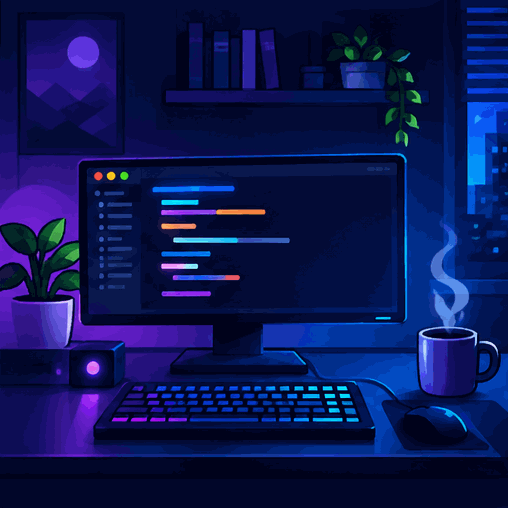

 

<table>
  <tr>
    <td width="50%" valign="middle" align="center">
      
    </td>
    <td width="50%" valign="middle" align="center">
      
    </td>
  </tr>
</table>

## 🌑 Sobre mim

Sou estudante de **Ciência da Computação na UERJ**. Minha especialidade é o **Back-End**: lógica de sistemas, APIs, regras de negócio e banco de dados. Estou em constante expansão para o **Front-End** para me tornar um desenvolvedor **Full Stack** completo.

Aprendo na prática: projetos, estruturas de dados, algoritmos, testes e código cada vez mais limpo.

## 👨‍💻 Habilidades

<table align="center">
  <thead>
    <tr>
      <th align="center" width="25%">🎨 Front-End</th>
      <th align="center" width="25%">⚙️ Back-End & APIs</th>
      <th align="center" width="25%">💾 Banco de Dados</th>
      <th align="center" width="25%">🛠️ Ferramentas & Infra</th>
    </tr>
  </thead>
  <tbody>
    <tr>
      <td align="center">   </td>
      <td align="center">   </td>
      <td align="center">   </td>
      <td align="center">   </td>
    </tr>
    <tr>
      <td align="center">   </td>
      <td align="center">   </td>
      <td align="center">   </td>
      <td align="center">   </td>
    </tr>
    <tr>
      <td align="center">   </td>
      <td align="center">   </td>
      <td></td>
      <td align="center">   </td>
    </tr>
    <tr>
      <td align="center">   </td>
      <td align="center">   </td>
      <td></td>
      <td align="center">   </td>
    </tr>
    <tr>
      <td align="center">   </td>
      <td align="center">   </td>
      <td></td>
      <td align="center">   </td>
    </tr>
    <tr>
      <td></td>
      <td align="center">   </td>
      <td></td>
      <td></td>
    </tr>
  </tbody>
</table>

## ⚙️ Projetos em Destaque

<b>➕ ExQuest</b> &nbsp;·&nbsp; — Clique Para Entrar

 

Plataforma de apoio aos estudos com questões, exercícios e simulados dinâmicos, pensada para tornar a prática e o acompanhamento do aprendizado mais organizados.

**Stack:** `Python` · `Flask` · `PostgreSQL`

[Explorar repositórios →](https://github.com/LGSFernandes/ExQuest)

<b>🛍️ E-Commerce Infantil</b> &nbsp;·&nbsp; — Clique Para Entrar

 

Aplicação de comércio eletrônico de vestimentas e utilitários infantis, com foco na organização das funcionalidades e na experiência de compra.

**Stack:** `Java` · `Spring Boot` · `PostgreSQL` · `Docker` · `Next.js`

[Explorar repositórios →](https://github.com/LGSFernandes/ModusWeb)

## 📊 Estatísticas

<table>
  <tr>
    <td width="50%" valign="top"></td>
    <td width="50%" valign="top"></td>
  </tr>
</table>

## 🧑‍💻 Setup em ação

## 🤝 Vamos conversar?

Aberto a trocar conhecimento, colaborar em projetos e conversar sobre tecnologia e computação.

 &nbsp;&nbsp; 

